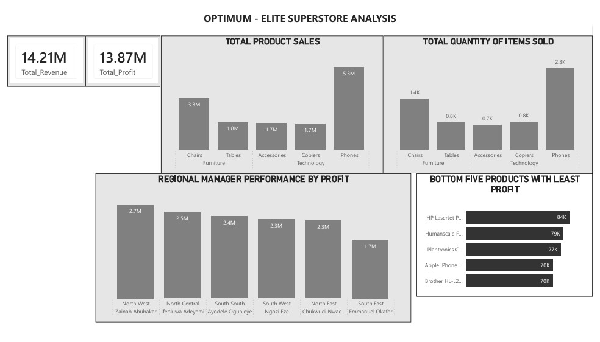
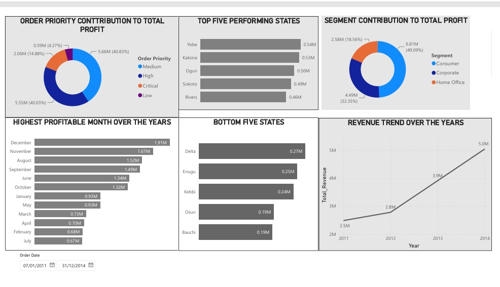

# Optimus-Elite Superstore Performance & Profitability Analysis

## Executive Summary

This project evaluates four years of commercial performance at Optimus-Elite Superstore, covering revenue growth, profitability, product concentration, regional efficiency, customer segments, order priority, state-level performance, and growth sustainability.

Between 2011 and 2014, the business generated approximately **₦14.21M in revenue** and **₦13.87M in profit** across 999 orders, 54 products, and 6,033 units sold.

Performance improved consistently over the period, with revenue increasing by approximately **103% from 2011 to 2014**.

However, the analysis also identified a highly concentrated profit structure, material differences across regions and states, underperforming products, and a significant contribution gap across order-priority groups.

The objective was therefore not only to identify where the business performed well, but to determine where profit concentration, regional imbalance, and portfolio inefficiency could limit future growth.

---

## Business Context

Optimus-Elite Superstore had several years of historical sales data but required a consolidated performance view that could answer questions beyond simple revenue reporting.

Management needed to understand:

- whether growth was consistent and sustainable
- which products generated the majority of profit
- which products underperformed relative to the portfolio
- which regions and managers were creating the strongest results
- where geographic performance gaps existed
- which customer segments contributed most to profitability
- how order priority affected commercial performance
- which periods represented exceptional performance and why

The analysis was designed to turn historical transaction data into a management decision-support framework.

---

## Analytical Objectives

The project focused on six major analytical areas:

### 1. Growth Performance
Assess revenue and profit trends across 2011–2014.

### 2. Product Portfolio Performance
Identify the strongest and weakest profit contributors.

### 3. Regional Efficiency
Compare performance across six regions and regional managers.

### 4. Geographic Concentration
Identify top- and bottom-performing states.

### 5. Customer & Order Mix
Evaluate profitability by customer segment and order priority.

### 6. Growth Opportunities
Identify commercially actionable opportunities for improving portfolio and regional performance.

---

## Tools & Analytical Methods

### Technology

- Power BI
- Power Query
- Microsoft Excel

### Analytical Techniques

- Revenue and profit trend analysis
- Product profitability analysis
- Regional performance benchmarking
- Manager-level performance comparison
- Customer segmentation
- State-level geographic analysis
- Order-priority analysis
- Contribution analysis
- Year-over-year growth analysis
- KPI development
- Executive dashboard design

---

## Data Scope

The dataset covered commercial activity from **2011 to 2014**, including:

- 999 orders
- 54 products
- 6,033 units sold
- 6 regions
- multiple customer segments
- product categories and sub-categories
- order priority
- state-level geography
- sales and profit measures

---

## Dashboard Preview

---

# Commercial Performance Diagnosis

## 1. Revenue Growth Was Strong and Consistent

Total revenue reached approximately **₦14.21M**, while total profit reached approximately **₦13.87M**.

Revenue increased every year between 2011 and 2014 and grew by approximately **103%** over the period.

### Business Interpretation

The overall trajectory indicates sustained commercial momentum rather than a one-off growth spike.

However, growth alone does not determine business quality.

The next analytical question is whether growth is broadly distributed across products and regions or dependent on a narrow set of high-performing contributors.

---

## 2. Profit Is Highly Concentrated in a Small Number of Product Categories

Phones generated approximately **₦5.35M in profit**, while Chairs generated approximately **₦3.34M**.

Together, these two sub-categories accounted for roughly **63% of total profit**.

### Business Interpretation

This concentration creates both a strength and a risk.

The business has clearly identified strong commercial categories, but an excessive dependence on a small number of products increases exposure to:

- demand shocks
- supplier issues
- pricing pressure
- inventory shortages
- competitor activity

Management should therefore protect these categories while improving the contribution of secondary products.

---

## 3. Several Products Underperform Relative to Portfolio Average

The five least-profitable products generated approximately:

- Brother HL-L2390DW Printer: **₦70K**
- Apple iPhone 12 Pro Max: **₦70K**
- Plantronics CS510 Headset: **₦77K**
- Humanscale Freedom Chair: **₦79K**
- HP LaserJet Pro MFP M428fdw: **₦84K**

These values were significantly below the approximate average product profit of **₦257K**.

### Business Interpretation

The presence of premium-branded products among the weakest profit contributors suggests that high selling price does not necessarily translate into strong profitability.

Potential causes include:

- high procurement costs
- discounting
- low transaction volume
- weak margin structure
- inventory inefficiency

These products warrant margin-level review rather than automatic discontinuation.

---

## 4. Regional Performance Shows Material Execution Gaps

The strongest region was the **North West**, led by Zainab Abubakar, generating approximately **₦2.72M in profit**.

The weakest region was the **South East**, generating approximately **₦1.71M**.

This represents a regional performance gap of roughly **₦1.01M**.

### Business Interpretation

The size of this gap suggests that geographic performance is not fully explained by company-wide product strategy.

Differences may exist in:

- regional demand
- sales execution
- account mix
- local pricing
- inventory availability
- manager effectiveness

The North West should therefore be used as a benchmark for identifying repeatable commercial practices.

---

## 5. Geographic Performance Is Uneven at State Level

Yobe recorded the highest state-level profit at approximately **₦538K**.

Bauchi recorded the lowest at approximately **₦188K**.

This represents a near threefold difference between the strongest and weakest states.

### Business Interpretation

The variation indicates that regional reporting alone may mask significant local performance differences.

State-level analysis should therefore be incorporated into future territory planning, inventory allocation, and sales-target setting.

---

## 6. Customer Profitability Is Concentrated in the Consumer Segment

The Consumer segment contributed approximately **49% of total profit**, compared with:

- Corporate: **32%**
- Home Office: **19%**

### Business Interpretation

The business is primarily consumer-driven.

That creates an opportunity to deepen retail customer value through:

- retention programmes
- targeted promotions
- product bundles
- repeat-purchase campaigns

However, it also suggests that Corporate and Home Office segments may represent underdeveloped growth opportunities.

---

## 7. Order Priority Shows a Strong Profit Contribution Imbalance

Medium-priority orders generated approximately **₦5.66M in profit**, while High-priority orders generated approximately **₦5.55M**.

Low-priority orders contributed only approximately **₦0.59M**.

### Business Interpretation

The Low-priority category contributes disproportionately little relative to the rest of the portfolio.

This may indicate:

- lower-value customers
- lower-value products
- weaker fulfilment
- lower transaction volume
- operational deprioritization

The key question is whether Low priority is inherently lower value or whether the current operating model is suppressing its performance.

---

## 8. June 2013 Represents an Exceptional Performance Event

June 2013 generated approximately **₦617K in profit**, making it the strongest month in the period analyzed.

### Business Interpretation

Peak months should not be treated as anomalies without investigation.

Management should determine whether the result was driven by:

- promotion activity
- seasonality
- stock availability
- major customer purchases
- pricing changes
- regional concentration

If identifiable and repeatable, these conditions could inform future commercial planning.

---

# Data Quality & Financial Validation

The reported gross margin is approximately **97.6%**.

This level is unusually high for a retail environment and should be validated against source data and finance records before being used externally.

### Analytical Implication

Possible explanations include:

- incomplete cost-of-sales data
- incorrect cost allocation
- source-data definition issues
- use of a simplified profit field
- missing operational costs

A senior-level interpretation should therefore treat the profit figures as analytically useful for relative comparison while recommending financial validation before strategic or investor-facing use.

---

# Strategic Recommendations

## 1. Protect High-Contribution Categories

Phones and Chairs should remain priority categories for:

- inventory availability
- supplier negotiations
- promotional spend
- customer acquisition activity

However, management should monitor concentration risk and avoid overdependence.

---

## 2. Conduct Margin Reviews on Underperforming Products

The bottom five products should be reviewed for:

- purchase cost
- pricing
- discounting
- sales volume
- inventory turnover

Products should only be removed after determining whether the issue is structural margin weakness or insufficient commercial execution.

---

## 3. Replicate North West Best Practices

Conduct a structured comparison between North West and South East operations.

Evaluate:

- customer mix
- salesperson productivity
- product mix
- promotional strategy
- average order value
- sales conversion
- stock availability

The goal should be to distinguish market effects from execution effects.

---

## 4. Rebalance Regional Performance

Introduce region-specific performance targets rather than relying only on national averages.

Management should monitor:

- revenue per region
- profit per region
- profit per order
- units per order
- product mix
- customer-segment mix
- manager performance

---

## 5. Investigate Low-Priority Orders

Determine whether Low-priority orders are intentionally lower-value or operationally underserved.

If the latter, process redesign may unlock additional profit without requiring new customer acquisition.

---

## 6. Expand Secondary Customer Segments

Corporate and Home Office customers together represent more than half of non-Consumer profit.

Targeted account strategies could reduce dependence on the Consumer segment and diversify the profit base.

---

## 7. Reproduce High-Performance Periods

Analyze the drivers of June 2013 and other peak periods.

Where repeatable factors exist, convert them into planned sales and inventory initiatives.

---

## 8. Validate Profitability Metrics

Before using the results for external reporting or major investment decisions, Finance should validate:

- cost-of-sales logic
- margin calculation
- cost allocation
- missing operational costs

This is particularly important given the unusually high reported gross margin.

---

# Executive KPI Framework

Future reporting should track:

- Revenue
- Profit
- Gross Margin
- Revenue Growth
- Profit Growth
- Profit by Product
- Product Contribution %
- Profit by Region
- Profit by State
- Profit by Customer Segment
- Average Order Value
- Units per Order
- Profit per Order
- Order Priority Mix
- Regional Variance

---

# Business Impact

This analysis reframes Optimus-Elite Superstore from a simple growth story into a more complete commercial performance picture.

The company is growing strongly, but its profit base is concentrated across a relatively small number of products and stronger-performing regions.

The most immediate opportunities are therefore not necessarily broad expansion, but:

- improving product portfolio efficiency
- reducing regional performance gaps
- protecting high-value categories
- improving underperforming products
- developing secondary customer segments
- understanding peak-period performance
- strengthening financial validation

The Power BI dashboard provides management with a framework for continuously monitoring these drivers and identifying where intervention is required.

---

## Skills Demonstrated

- Business Intelligence
- Power BI Dashboard Development
- Power Query
- Retail Analytics
- Profitability Analysis
- Product Portfolio Analysis
- Regional Performance Benchmarking
- Geographic Analysis
- Customer Segmentation
- Growth Analysis
- Contribution Analysis
- KPI Development
- Data Quality Assessment
- Executive Reporting
- Commercial Performance Diagnosis
- Strategic Recommendation Development
- Data Storytelling

---

## Project Files

- [Power BI Dashboard](Optimum_Elite_Supestore_Analysis.pbix)
- [Dataset](Optimus_Elite_Superstore_Excel.xlsx)
- [Business Performance Report](Optimus_Elite_Analysis.pptx)
